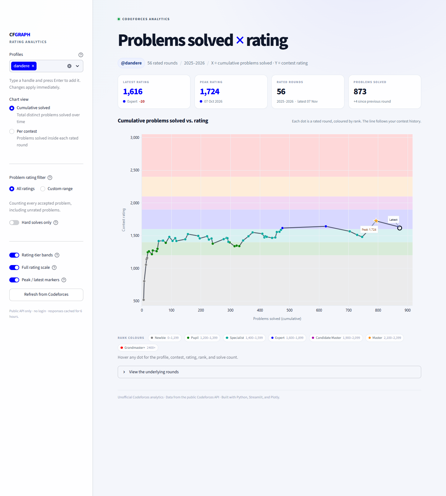
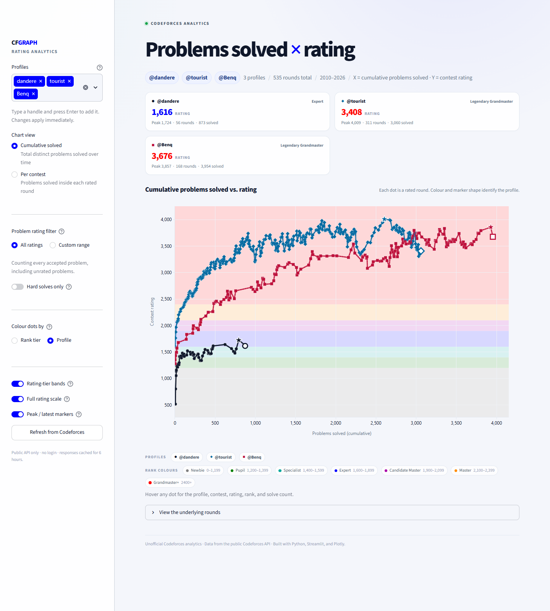
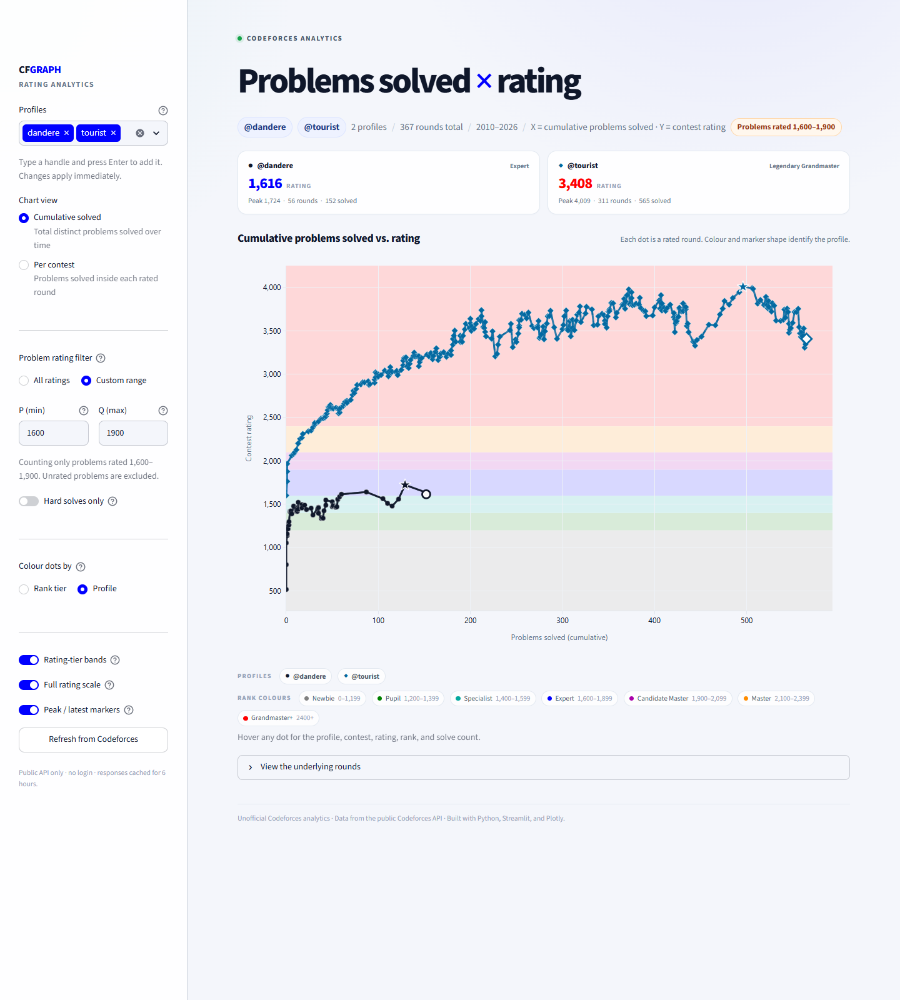
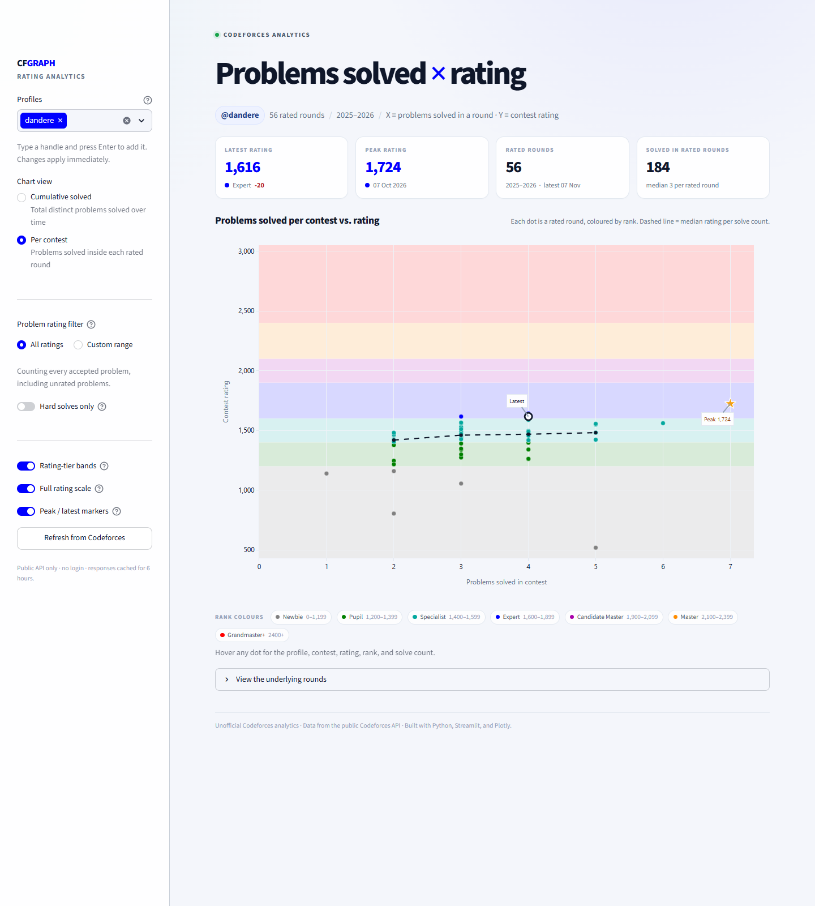
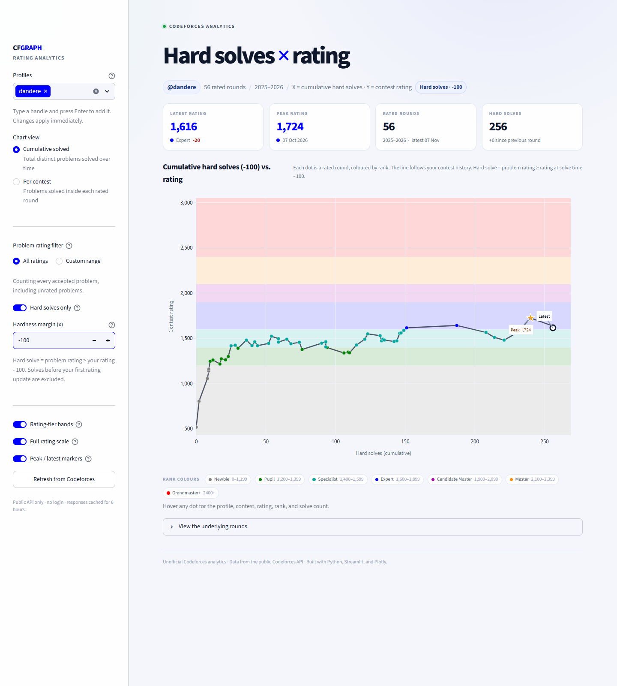

# Codeforces problem-solving dashboard

An interactive Streamlit dashboard for one or several Codeforces profiles. It plots:

- **X axis:** problems solved
- **Y axis:** contest rating
- **Colour:** Codeforces rank tier or profile, depending on the display mode

The app uses the public Codeforces API. No login or API key is required.



## Run

```powershell
python -m pip install -r requirements.txt
python -m streamlit run streamlit_app.py
```

Then open the URL Streamlit prints, usually:

```text
http://localhost:8501
```

The default profile is loaded on first launch. Change the profile selection in
the sidebar at any time; the dashboard updates immediately.

If the sidebar is collapsed, use the circular **»** button at the top-left to
reopen it.

## Multiple profiles

The **Profiles** picker supports up to five handles:

- Choose an existing suggestion, or type a new handle and press **Enter**.
- Every selected profile is drawn on the same axes.
- Profile cards compare latest rating, peak rating, rated rounds, and solved
  counts.
- In **Profile** colour mode, each handle gets its own colour and marker shape.
- In **Rank tier** colour mode, marker fill follows the Codeforces palette and
  marker shape identifies the profile.



## Problem-rating filter

Use **Problem rating filter** to count only accepted problems whose problem
rating falls inside a chosen range:

- Choose **Custom range** and enter **P (min)** and **Q (max)**.
- The initial values are **P = 1600**, **Q = 1900**.
- Both values accept 0–4000, in 100-point steps.
- Problems with no rating are excluded while a custom range is active.
- The filter applies to every selected profile and to both chart views.
- The active range is shown as a pill in the page header.

For example, with **P = 1600** and **Q = 1900**, the dashboard answers:
*“How many 1600–1900-rated problems had each profile solved by each contest?”*
Leave the filter on **All ratings** to count every accepted problem as before.



## Two views

### Cumulative solved

- Every point is one rated round.
- X = filtered, distinct problems accepted up to that rating update.
- Y = rating after the round.
- The line follows the rounds in chronological order.

### Per contest

- Every point is one rated round.
- X = filtered, distinct problems accepted during that contest's official
  window.
- Y = rating after the round.
- For a single profile, the dashed line is the median rating for each solve
  count.



## Interactivity

- **Hover** a point for profile, contest name, date, rank, exact rank tier, and
  solve count.
- **Zoom / pan** in the chart; scroll to zoom.
- Toggle **Rating-tier bands** for Codeforces rank background bands.
- Toggle **Full rating scale** to keep every rank colour visible up to 3000+,
  even when your peak is lower.
- Toggle **Peak / latest markers**.
- Toggle **Hard solves only** and set a **Hardness margin (x)** to require a
  problem rating at least `your rating + x`. Positive margins are harder;
  negative margins are easier.
- Switch views and profiles without restarting the app.
- Expand **View the underlying rounds** for a sortable table.
- **Download CSV** of every rated round for the selected profiles.

## Rank colours

The dashboard uses the official Codeforces rank palette:

| Rating | Rank | Colour |
| --- | --- | --- |
| 0–1199 | Newbie | `#808080` grey |
| 1200–1399 | Pupil | `#008000` green |
| 1400–1599 | Specialist | `#03A89E` teal |
| 1600–1899 | Expert | `#0000FF` blue |
| 1900–2099 | Candidate Master | `#AA00AA` violet |
| 2100–2399 | Master / International Master | `#FF8C00` orange |
| 2400+ | Grandmaster / IGM / Legendary Grandmaster | `#FF0000` red |

The exact rank name (for example “International Master” at 2300–2399) appears
in the hover tooltip and metric cards.

By default, **Full rating scale** extends the Y axis to 3000+ so every rank
colour is visible even if your peak is lower. Turn it off to zoom the Y axis
tightly around your own rating range.

## Hard solves

Enable **Hard solves only** to count a problem only when its Codeforces problem
rating is **greater than or equal to your rating when you solved it**.

Use **Hardness margin (x)** to raise that bar:

```text
problem rating >= your rating at solve time + x
```

- `x = 0` is the original rule.
- `x = 100` means you only count problems at least 100 points above your
  rating at the time.
- `x = -100` means you also count problems up to 100 points below your rating
  at the time.
- The margin accepts -3000 to 3000, in 50-point steps.
- For a solve during a rated round, the comparison uses the rating you carried
  **into** that round — rating updates happen after the contest.
- For practice/upsolving submissions, it uses your latest rating update before
  the accepted submission.
- Solves made before your first rating update are excluded because there is no
  rating-at-the-time yet.
- Problems with no Codeforces difficulty rating are excluded.
- Hard-solve mode combines with the P/Q filter: both conditions must hold.
- The stats card, chart title, axis label, hover text, and CSV all switch to
  “hard solves” terminology.

This is **not** Codeforces’ own “hard problem” label. It is relative to the
user: a 1700-rated problem is hard for a 1500-rated user, but not for a
1900-rated user.



## What counts as solved

Only submissions with verdict `OK` count, and repeated accepted submissions to
the same problem count once. The API submission list is paginated when needed.

For **Per contest** mode, the app fetches `contest.list` once and only counts
accepted problems whose timestamps fall inside the contest's official
`startTimeSeconds` to `startTimeSeconds + durationSeconds` window. Later
practice/upsolving submissions do not inflate a contest result.

## API usage and caching

| Method | Purpose |
| --- | --- |
| `user.rating` | Rated contest history and rating changes |
| `user.status` | Submissions and problem ratings |
| `contest.list` | Contest start times and durations (Per contest mode) |

Requests are spaced by at least 2.05 seconds, matching Codeforces' public API
request limit. Responses are cached on disk for 6 hours (24 hours for the
contest list) in `.cache/`.

- **Refresh from Codeforces** clears the in-memory cache and forces a fresh API
  fetch for all selected profiles.
- `st.cache_data` keeps parsed profiles in memory for fast profile and view
  switching.

## Optional static PNGs

The shared data module also includes a matplotlib renderer for one profile:

```powershell
python cf_rating_vs_solved.py tourist --mode cumulative
python cf_rating_vs_solved.py tourist --mode contest
```

Outputs go to `output/tourist_cumulative.png` and
`output/tourist_contest.png`.

## Project files

| File | Purpose |
| --- | --- |
| `streamlit_app.py` | Streamlit UI, Plotly charts, profile picker, P/Q filter, hard-solve mode, data table |
| `cf_rating_vs_solved.py` | Shared Codeforces API client, caching, pagination, calculations, static PNG renderer |
| `requirements.txt` | Python dependencies |
| `.streamlit/config.toml` | Streamlit theme and server defaults |
| `output/` | Example screenshots and static charts |

## Notes

- A user must have at least one rated contest.
- The latest point is the most recent rated round, not necessarily the current
  Codeforces profile rating if a round is in progress.
- The problem-rating filter uses Codeforces' problem difficulty rating, not the
  contest rating on the Y axis.
- This is an unofficial project. Data is provided by the Codeforces public API.
